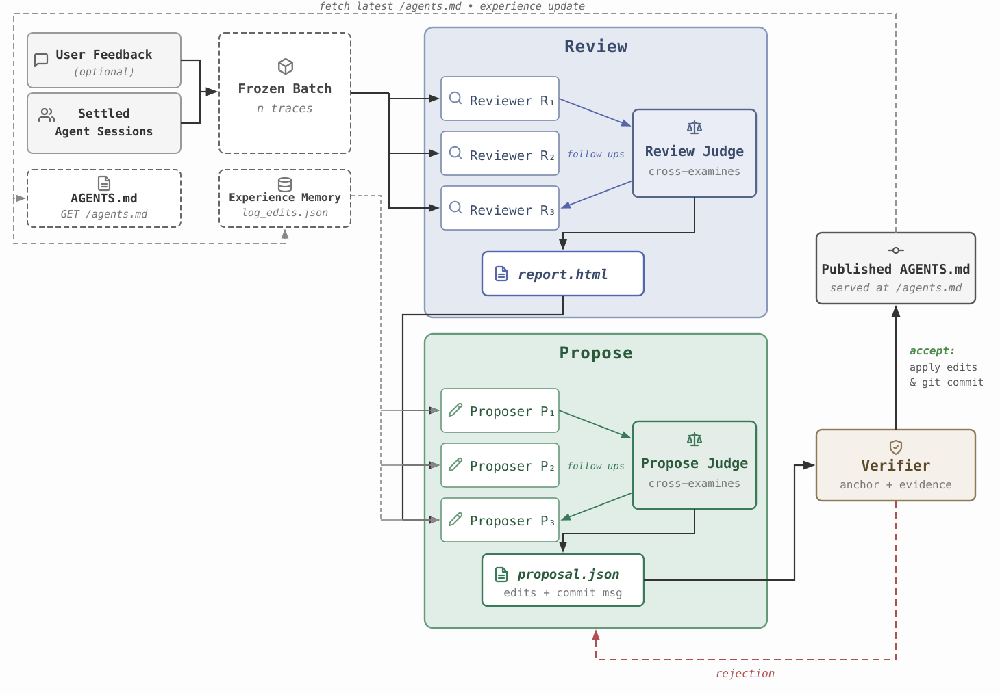
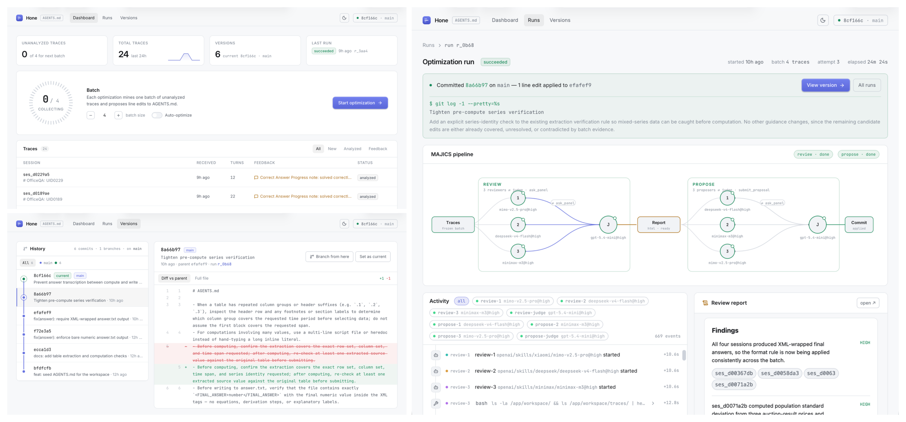

<div align="center">

# Hone

**Mining Agent Trajectories to Optimize AGENTS.md via Cross-Examination**

</div>




## Motivation

- Coding agents carry an instruction file (AGENTS.md) in the system prompt. Writing and maintaining it is manual trial and error.
- Handwritten context files improve task success by at most 4% and inflate inference cost by over 20%; naively generated ones reduce success.
- Existing skill optimizers assume each edit can be scored by re-running the task with a pass/fail verifier. Real sessions are one-shot, and feedback is free text at most.
- Hone removes both assumptions: it mines settled session traces and edits AGENTS.md without re-running anything.

## How it works

1. The agent runs benchmark tasks in Harbor sandboxes. Traces and verdicts stream to the service.
2. Review stage: a panel of models reads the failures, a judge cross-examines them into one report.
3. Propose stage: a second panel drafts edits, a judge fuses them into a patch and commit message.
4. The service verifies the patch and commits it. The version graph is a real Git repo, every iteration a commit authored by the judge.

## Dashboard



## Quick start

```bash
uv sync
export OPENAI_API_KEY=...
uv run uvicorn hone.api:app --host 127.0.0.1 --port 8080
```


Config in `hone.yaml` (models, panels, judges). API token: `HONE_TOKEN`.
